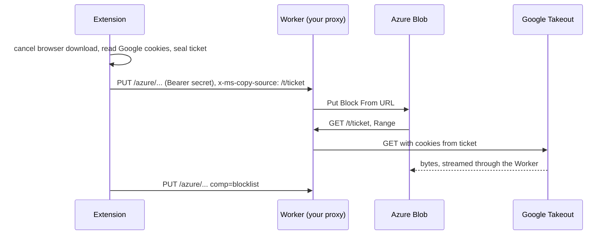

# Gargantuan Takeout Rocket Extension

Browser extension that copies Google Takeout archives to your own Azure Blob Storage container without the data passing through your computer. It intercepts each Takeout download, seals the download URL and your Google cookies into an encrypted ticket, and has Azure fetch the archive server side through a Cloudflare Worker you deploy. Archives move at datacenter speed, in parallel, while your browser only sends small control requests.

This is a fork of [nelsonjchen/gtr-ext](https://github.com/nelsonjchen/gtr-ext) with an incompatible protocol. It works only with [kjiwa/gtr-proxy](https://github.com/kjiwa/gtr-proxy), and there is no public proxy.

## How it works



Azure's `Put Block From URL` can fetch a URL but cannot send cookies, so the Worker fetches from Google on Azure's behalf. The extension splits each archive into blocks, stages them in parallel, then commits the block list. See the [proxy README](https://github.com/kjiwa/gtr-proxy#readme) for the Worker side.

## Security model

- The extension reads your Google cookies for the Takeout hosts and sends them only inside a ticket: AES-256-GCM under a key derived from your secret, with a 6 hour expiry. Azure and Cloudflare logs see ciphertext.
- The proxy sees your cookies and SAS token in transit. Deploy your own Worker. There is no built-in or default proxy.
- The extension acts only on downloads whose URL matches Google Takeout hosts. Every other download is left alone, even when interception is on.
- Requests to the Worker carry `Authorization: Bearer <secret>`. Without the secret nobody can use your Worker as a relay.
- The secret, proxy URL and SAS URL are stored in the extension's local storage in plain text. Any code that can read it already runs as the extension or as you on your machine, where it could read the same cookies, and the secret protects only your own Worker and your own container until the SAS expires.
- The proxy URL needs a host permission that the extension requests when you save settings. It is optional, so the extension holds no access to other sites by default.

| Permission                                   | Why                                                                        |
| -------------------------------------------- | -------------------------------------------------------------------------- |
| `downloads`                                  | Detect Takeout downloads, cancel them and read the filename.               |
| `cookies`                                    | Read the Google cookies the ticket carries.                                |
| `storage`                                    | Keep settings and transfer state.                                          |
| `notifications`                              | Report finished and failed transfers.                                      |
| `https://takeout.google.com/*`               | Cookie access for the Takeout page host.                                   |
| `https://*.google.com/*`                     | Cookie access for `takeout-download.usercontent.google.com`.               |
| `https://*.googleusercontent.com/*`          | Cookie access for `apidata.googleusercontent.com` download hosts.          |
| `https://storage.googleapis.com/*`           | Cookie access for Takeout archives served from Cloud Storage.              |
| Optional: `https://*/*`, localhost addresses | Contact your proxy. Requested for the proxy origin only, when you save it. |

## Requirements

- Chrome, Chromium, Edge or Brave 121 or later, or Firefox 140 or later.
- A Cloudflare account to deploy the [proxy](https://github.com/kjiwa/gtr-proxy).
- An Azure storage account.

## Install

Download `gtr-ext-<version>.zip` from [Releases](https://github.com/kjiwa/gtr-ext/releases) and unzip it into a folder you keep.

Chrome, Chromium, Edge, Brave: open `chrome://extensions`, turn on Developer mode, choose Load unpacked, and pick the unzipped folder.

Firefox: open `about:debugging#/runtime/this-firefox`, choose Load Temporary Add-on, and pick `manifest.json` inside the unzipped folder. Firefox unloads a temporary add-on when it quits, so load it again each session.

## Setup

1. Deploy the proxy by following [gtr-proxy](https://github.com/kjiwa/gtr-proxy#readme).
2. Create an Azure storage account and a container in it.
3. Generate a container SAS URL. In the portal, open the container, choose Shared access tokens, grant at least Write or Create, set an expiry, and copy the Blob SAS URL (portal labels unverified). With the CLI (flags checked against `az storage container generate-sas --help`; the command itself was not run against a real account):

   ```sh
   az storage container generate-sas \
     --account-name <account> --name <container> \
     --permissions racw --expiry <YYYY-MM-DDTHH:MMZ> \
     --https-only --auth-mode login --as-user -o tsv
   ```

   The command prints a token. The SAS URL is `https://<account>.blob.core.windows.net/<container>?<token>`. The extension accepts a container-level SAS whose permissions include `w` or `c`; `racw` satisfies that check.

4. Open the extension's settings. Paste the proxy URL, generate a secret (or paste yours), set the same secret on the Worker, paste the SAS URL, choose Test connection, then Save. Grant access to the proxy origin when the browser asks.
5. Open the popup and turn on interception.

## Usage

Start a Takeout export in Google Takeout and click each download link. The extension cancels the browser download and has Azure copy the archive instead. The popup lists each transfer with its progress and a cancel button. Failed and interrupted transfers stay listed until you choose Clear finished.

Interrupted means the browser or the extension restarted during the copy. Start that download again in Takeout.

## Troubleshooting

| Symptom                                                            | Cause and fix                                                                                |
| ------------------------------------------------------------------ | -------------------------------------------------------------------------------------------- |
| Test connection: "The proxy rejected the secret (401)"             | The secret here differs from `GTR_SECRET` on the Worker. Set the same value on both.         |
| Test connection: "The Worker has no GTR_SECRET (503)"              | Run `npx wrangler secret put GTR_SECRET` in the proxy project.                               |
| "Could not reach the proxy"                                        | Wrong URL, no network, or access to the proxy origin not granted. Save settings and approve. |
| "The proxy rejected the ticket"                                    | The secret does not match, or the URL is not a Takeout download.                             |
| The SAS URL has expired / "Azure rejected the SAS URL"             | Generate a new SAS and save it.                                                              |
| "The SAS URL needs write (w) or create (c) permission"             | Regenerate the SAS with `racw`.                                                              |
| "The Takeout cookie is too large" (`ticket_too_long`)              | Sign out of Google accounts you do not need, then start the download again.                  |
| "Google did not return the archive. Sign in to Google"             | Your Takeout session lapsed. Sign in and start the download again.                           |
| "The ticket expired"                                               | The link sat too long. Start the download again.                                             |
| "Azure could not read the Takeout archive through the proxy"       | The ticket expired or Google refused the cookie. Start the download again.                   |
| "The browser or extension restarted during the copy" (Interrupted) | Start the download again in Takeout.                                                         |

## Development

```sh
npm ci
npm run lint        # eslint and prettier
npm run typecheck
npm test            # vitest
npm run build       # writes dist/
npm run lint:ext    # web-ext lint on dist/
npm run pkg         # builds a production dist/ and writes gtr-ext-<version>.zip
```

Load `dist/` as an unpacked extension as described under Install. `npm run build:watch` rebuilds on change.

`test/vectors.json` pins the ticket format and URL rules and is byte-identical to the copy in gtr-proxy. CI fails if it differs from the proxy's `master`; locally, `test/vectors.sync.test.ts` compares against `../gtr-proxy` when that checkout exists.

Release: set `version` in `static/manifest.json`, then push a tag `vX.Y.Z`. CI builds the zip and attaches it to a GitHub release.

`web-ext lint` reports a warning that `background.service_worker` is ignored on Firefox and one that Firefox for Android is not covered by `strict_min_version`. The manifest lists both `service_worker` (Chrome) and `scripts` (Firefox) on purpose, and the extension targets desktop.

## Privacy

The extension has no telemetry and sends nothing anywhere except to the proxy you configure.

## License

MIT. See [LICENSE](LICENSE). The rocket logo is from Twemoji.
